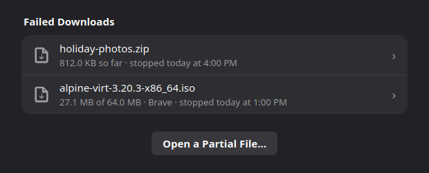
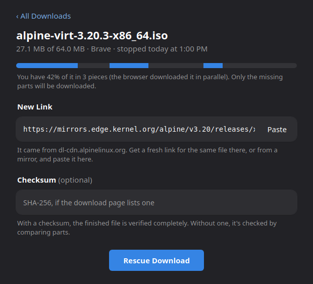
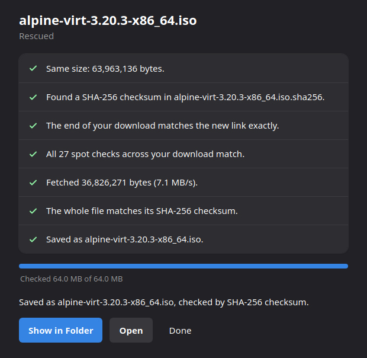
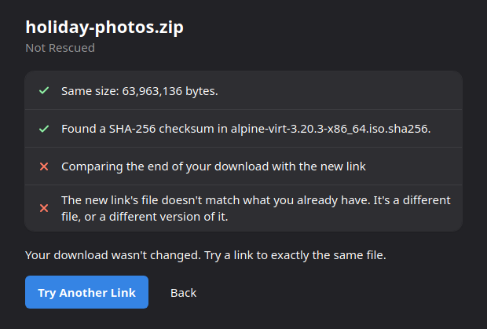

# DownloadRescue

Finish a failed download from a new link, instead of starting over.

Your browser stops at 97% of a 30 GB file, and the link has expired by the
time you notice. Get a fresh link to the same file (from the same site, or a
mirror), paste it into DownloadRescue, and it downloads only what's missing,
checks that it really is the same file, and saves it under its real name.



## Without corrupting the file

Joining pieces of a file from two different links is easy to get wrong, and
the result is a file that looks complete but doesn't work. DownloadRescue
checks before it writes anything, and never risks what you already have:

- **Same size.** The new link's file must be exactly as big as the one your
  browser was downloading.
- **The end matches.** The last megabyte you have is downloaded again from
  the new link and compared byte for byte. If only the very end of your file
  is damaged (a write cut short when the download failed), that bit is set
  aside and fetched again. If nothing matches, it's a different file and
  nothing happens.
- **Spot checks.** Small samples from across the rest of your file are
  compared too, so a different version of the file is caught.
- **Your bytes are never rewritten.** Only missing parts are written.
  Anything about to be overwritten is backed up first.
- **Checksum.** If the site publishes a SHA-256 next to the file
  (`file.iso.sha256`, `SHA256SUMS`), DownloadRescue finds it by itself and
  verifies the whole finished file. You can also paste one. If it doesn't
  match, your download is put back exactly as it was.
- **Only then** does the file get its real name, never replacing another
  file with the same name.





And when the new link is for a different file:



## Downloads it finds by itself

- **Brave, Chrome, Chromium, Edge, Vivaldi and Opera.** These browsers record
  failed downloads, including how big the file should be and, for downloads
  fetched in several pieces at once, exactly which pieces arrived. A naive
  resume treats the empty gaps between those pieces as data and ends up
  with a broken file; DownloadRescue fills them in.
- **Any `.crdownload` or `.part` file** in your Downloads folder, including
  Firefox's. Without the browser's record, the new link supplies the size.
- **Anything else** with **Open a Partial File…**.

It reads the browser's download records from a copy and changes nothing in
the browser.

## What it can't do

- **The new link must be the same file**, byte for byte. A different
  version is refused when the checks catch it. The spot checks catch almost
  every difference, but only a checksum is certain, so add one if the site
  lists it.
- **Links that need you to be signed in** won't work: DownloadRescue doesn't
  use your browser's cookies. Links that work in a private window are fine.
- **Servers that can't send part of a file** make it read the whole file
  again. It still compares everything you had on the way, and writes only
  what's missing.

## Install

```sh
git clone https://github.com/BeansAsset/downloadrescue.git ~/downloadrescue
~/downloadrescue/install-integration.sh
```

The setup script adds DownloadRescue to your apps menu. If something is
missing, it shows the command for your distro:

| Distro | Command |
| --- | --- |
| Linux Mint, Ubuntu, Debian, Pop!_OS | `sudo apt install python3-gi gir1.2-gtk-3.0 gir1.2-webkit2-4.1` |
| Fedora | `sudo dnf install python3-gobject gtk3 webkit2gtk4.1` |
| Arch, Manjaro | `sudo pacman -S --needed python-gobject gtk3 webkit2gtk-4.1` |
| openSUSE | `sudo zypper install python3-gobject typelib-1_0-Gtk-3_0 typelib-1_0-WebKit2-4_1` |

Works on X11 and Wayland. Tested on Linux Mint 22 with Brave, rescuing a
real 64 MB Linux image downloaded in three pieces from one mirror and
finished from another, verified against its published checksum.

## In a terminal

```sh
./downloadrescue-app "Unconfirmed 482913.crdownload" https://mirror.example/file.iso
./downloadrescue-app file.iso.part https://example.com/file.iso --sha256 81df854f…
```

```
  ok  Same size: 63,963,136 bytes.
  ok  Found a SHA-256 checksum in alpine-virt-3.20.3-x86_64.iso.sha256.
  ok  Matches. The last 4,096 bytes on disk were damaged; they'll be fetched again.
  ok  All 25 spot checks across your download match.
  ok  Fetched 38,965,232 bytes (11.8 MB/s).
  ok  The whole file matches its SHA-256 checksum.
  ok  Saved as alpine-virt-3.20.3-x86_64.iso.
```

## How it works

```
rescue/
  engine.py     the rescue: checks, filling the gaps, backups, undo
  remote.py     talking to the new link; every answer is checked
  checksum.py   finding a published SHA-256 next to the file
  finder.py     failed downloads in browsers' records and the Downloads folder
  ranges.py     which byte ranges are good, and which are missing
  main.py       the window and the terminal command
  web/          the window (HTML, CSS, JS)
tools/          setup for any common distro
tests/          python3 -m unittest discover -s tests
```

The tests run every rescue against a local server that can drop connections,
lie about which part it sent, ignore range requests, or serve a different
file, and check that a refused rescue leaves the partial file byte for byte
as it was.

## License

GPL-3.0-or-later (`LICENSE`).
